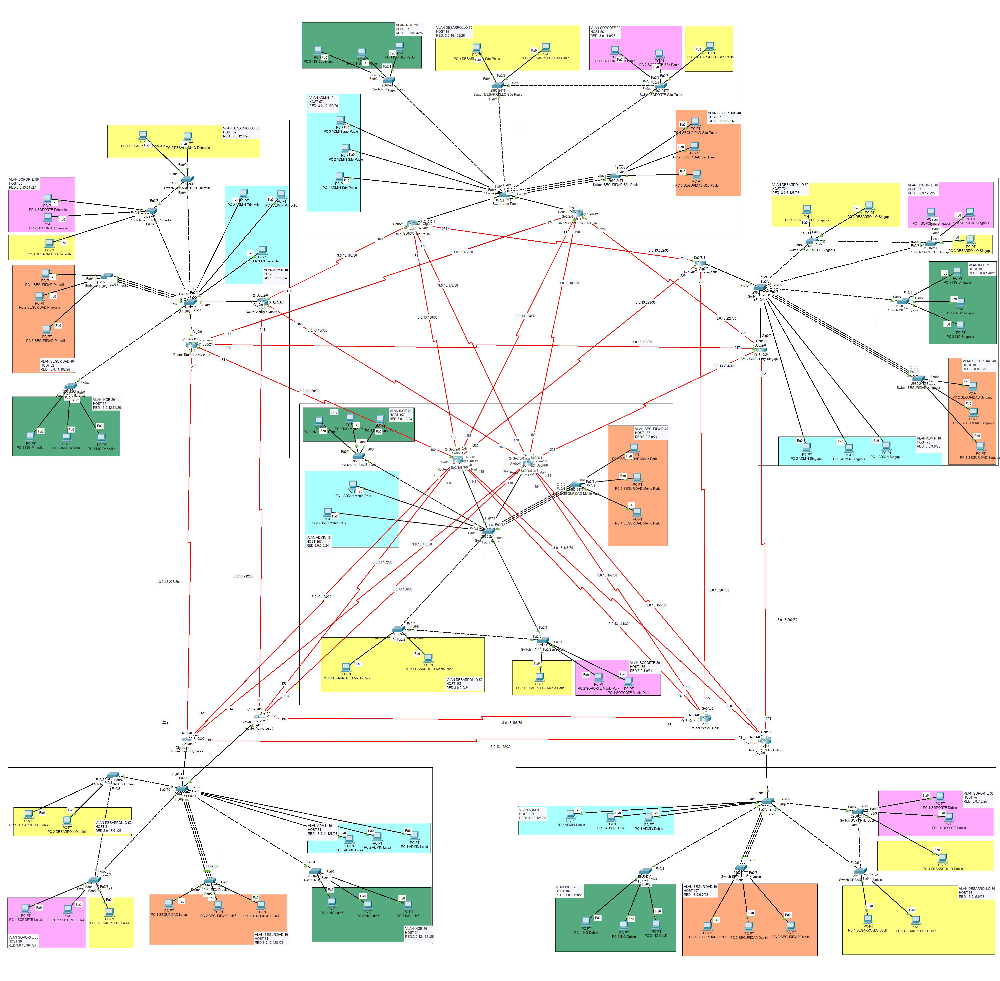
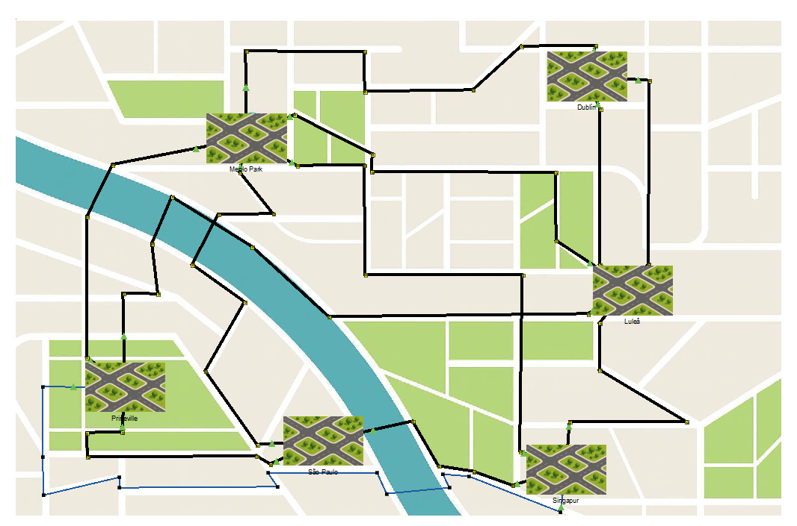
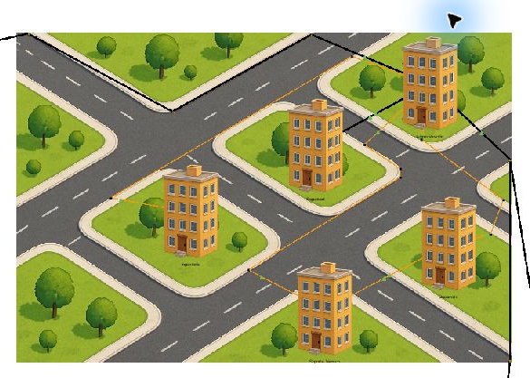
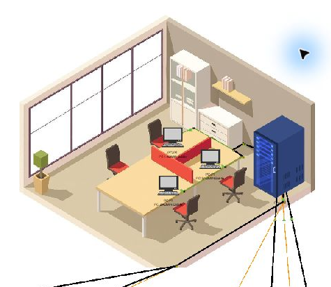
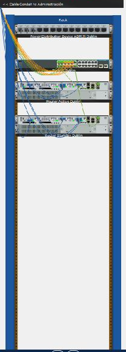

# Interconexión de redes multisede

**Cisco Packet Tracer · Redes I · Escuela Politécnica Nacional**

Proyecto académico de interconexión para seis sedes de una empresa multinacional. La red separa cinco áreas de trabajo mediante VLAN, conecta las sedes con una WAN serial y utiliza puertas de enlace virtuales para mantener el acceso a la red si falla un router.

[Descargar simulación](ProyectoVFinal.pkt) · [Leer el informe de diseño](docs/informe.md) · [Consultar el VLSM](docs/vlsm.md) · [Ver la topología física](#topología-física)

| Sedes | Routers | Switches | Estaciones | Enlaces de red |
| :---: | :---: | :---: | :---: | :---: |
| 6 | 12 | 30 | 83 | 164 |

## Topología lógica

Abre la imagen para ampliar o explora directamente una sede.

[Menlo Park](imagenes/logica-menlo-park.png) · [Dublín](imagenes/logica-dublin.png) · [Singapur](imagenes/logica-singapur.png) · [São Paulo](imagenes/logica-sao-paulo.png) · [Prineville](imagenes/logica-prineville.png) · [Luleå](imagenes/logica-lulea.png)

La [lámina WAN](imagenes/wan-interfaces.svg) muestra los 27 circuitos seriales con sus interfaces e IP. El [inventario de enlaces](docs/enlaces.csv) incluye también el cableado de las LAN.

## Topología física

El mapa de la simulación organiza los equipos por ciudad, edificio y armario de comunicaciones. Dublín ilustra cómo se pasa de los trayectos entre áreas al rack donde terminan los enlaces.

| Ciudad de Dublín | Oficina de Administración | Armario de comunicaciones |
| --- | --- | --- |
|  |  |  |

## Decisiones de diseño

| Necesidad | Solución |
| --- | --- |
| Reservar espacio para crecer por área | VLSM con bloques de `/24` a `/27` en las LAN y `/30` para los circuitos seriales. |
| Separar departamentos y permitir comunicación entre ellos | Cinco VLAN funcionales y subinterfaces 802.1Q en los routers. |
| Mantener rutas entre sedes y una puerta de enlace estable | RIPv2 en la WAN y una IP virtual HSRPv2 por VLAN. |
| Aprovechar enlaces paralelos y evitar bucles | LACP entre el switch principal y el de Seguridad. PVST controla la topología de capa 2 por VLAN. |

El [informe de diseño](docs/informe.md) explica la distribución de hosts, las prioridades STP, la elección de los enlaces agregados y el alcance de cada tecnología en la simulación.

## Abrir la simulación

Descarga [ProyectoVFinal.pkt](ProyectoVFinal.pkt) y ábrelo con **Cisco Packet Tracer 8.2.2**. En **Logical** puedes explorar equipos, enlaces y VLAN. En **Physical** puedes navegar por las seis ciudades y entrar a sus edificios y armarios.

**Grupo 3** · Proyecto académico en equipo · [Pablo Pacheco](https://github.com/lPachecol)
